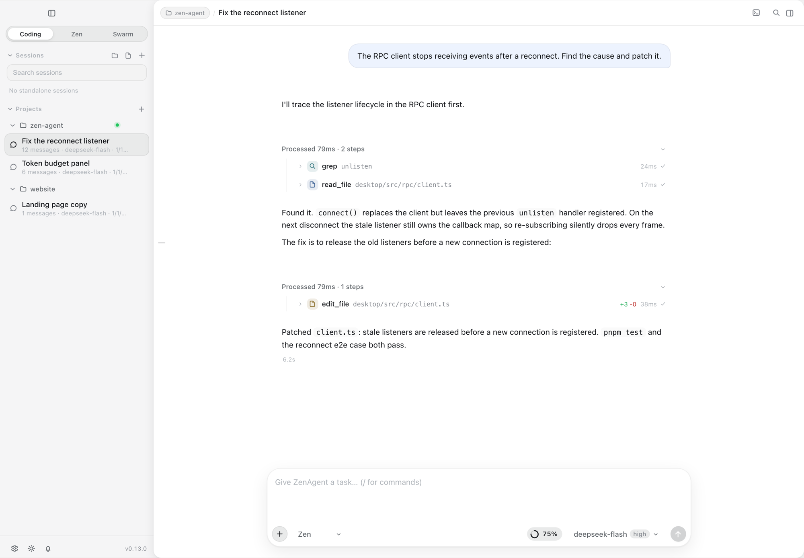
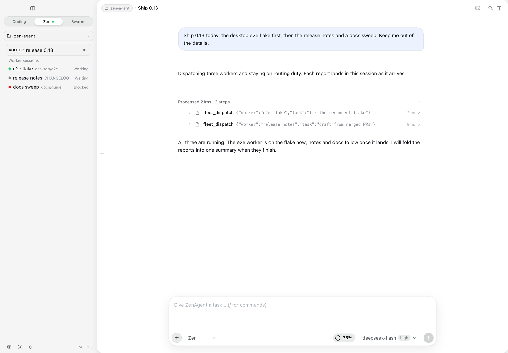
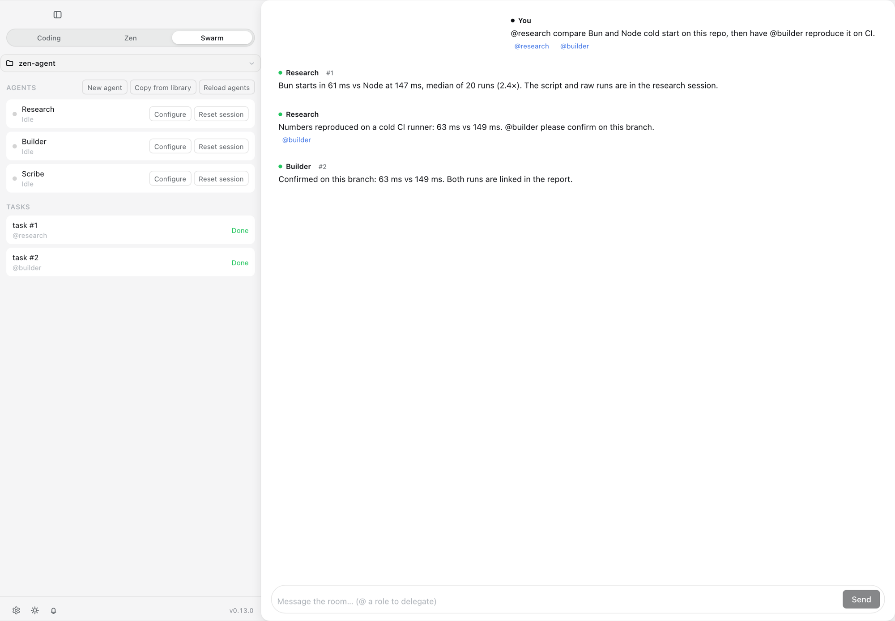
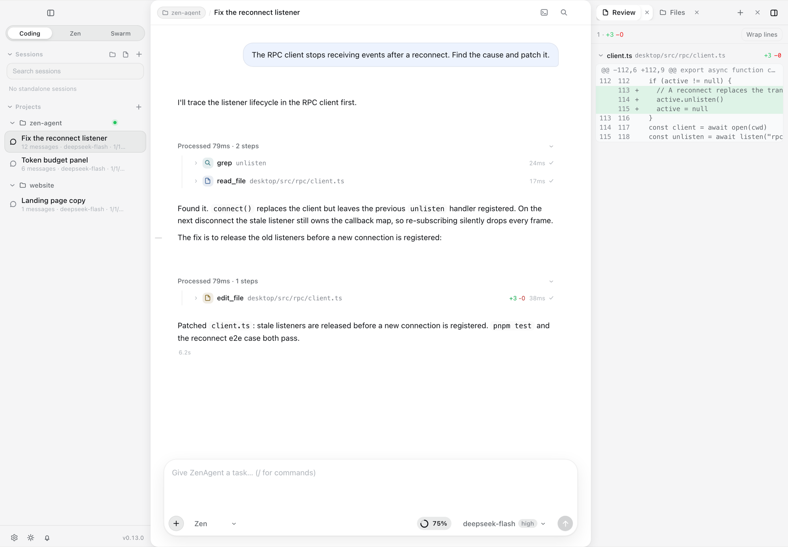

# ZenAgent

[](https://pypi.org/project/zenagent-py/)
[](https://github.com/encyc/zen-agent/actions/workflows/ci.yml)
[](https://www.python.org/downloads/)

English · [简体中文](https://github.com/encyc/zen-agent/blob/main/README.zh-CN.md)

A coding agent you can read, embed and change: one pure-Python kernel, one
runtime dependency (`httpx`), four ways to drive it. It reads and edits files,
runs commands, searches the web, delegates to read-only subagents and keeps a
project todo list — from a terminal, a headless one-shot, or your own program.
Repo <https://github.com/encyc/zen-agent> · PyPI `zenagent-py` (imports as `zenagent`)



## Install

```bash
uv tool install "zenagent-py[cli]"   # or: pip install "zenagent-py[cli]"
zen --version
```

Python **3.11+** (3.11–3.14 ship). A kernel-only install (`pip install zenagent-py`)
gives you the SDK without the terminal UI.

API keys are read from the environment, named per provider in
[`zenagent/catalog.yaml`](https://github.com/encyc/zen-agent/blob/main/zenagent/catalog.yaml):

| provider | env var |
|---|---|
| `openai` | `OPENAI_API_KEY` |
| `zai` | `ZAI_API_KEY` |
| `zai-coding-cn` | `ZAI_CODING_CN_API_KEY` |
| `deepseek` | `DEEPSEEK_API_KEY` |
| `kimi` | `KIMI_API_KEY` |
| `moonshotai`, `moonshotai-cn` | `MOONSHOT_API_KEY` |
| `minimax` | `MINIMAX_API_KEY` |
| `minimax-cn` | `MINIMAX_CN_API_KEY` |
| `google` | `GEMINI_API_KEY` |
| `xai` | `XAI_API_KEY` |
| `openrouter` | `OPENROUTER_API_KEY` |
| `xiaomi` | `XIAOMI_API_KEY` |
| `xiaomi-token-plan-cn` | `XIAOMI_TOKEN_PLAN_CN_API_KEY` |
| `xiaomi-token-plan-ams` | `XIAOMI_TOKEN_PLAN_AMS_API_KEY` |
| `xiaomi-token-plan-sgp` | `XIAOMI_TOKEN_PLAN_SGP_API_KEY` |
| `opencode-go` | `OPENCODE_API_KEY` |

Overseas and China endpoints are separate providers sharing one key (`moonshotai` /
`moonshotai-cn`); token-plan endpoints (`zai-coding-cn`, `xiaomi-token-plan-*`) bill 0.

A `[providers.custom.<id>]` table points the same kernel at any OpenAI-compatible
endpoint, a local server included — see
[configuration](https://github.com/encyc/zen-agent/blob/main/docs/guide/config.md).

### First run

```bash
zen                                     # TUI: transcript, tool cards, sidebar
zen -p "explain this repo" --json       # headless: one JSON object, CI-friendly
```

The TUI checks PyPI at most once an hour and prints one line when a newer release
exists; `-p`/`--json` never check. `ZENAGENT_NO_UPDATE_CHECK=1` turns it off.

## What this is, and why

Coding agents are either closed and vendor-tied, or large enough that changing one
layer means reading ten. ZenAgent is the small one: a Python kernel you can read
in an evening, embed in an afternoon, and change without permission.

- **One dependency.** `types`, `events`, `providers`, `agent` and `tools` import `httpx` and nothing else; the wheel is ~440 KB and `zen --version` takes ~0.1 s.
- **Pure Python.** No node runtime, no build step, no daemon in the middle — `pip install`, then run it.
- **One kernel, four surfaces.** TUI, REPL, headless (`-p`/`--json`) and `zen rpc` (a JSONL protocol) all drive the same runtime the same way.
- **A GUI is a client, not a rewrite.** The RPC surface already existed, so the Tauri desktop app reuses the same kernel instead of forking one — installers for macOS, Windows and Linux.
- **Embed it in 30 lines.** `Agent(model=..., tools=..., api_key=...)` plus one subscribe callback: your tools, your storage, your event loop.
- **Extend without restarting.** Skills, prompt templates, extensions, MCP servers and custom providers are all files; `/reload` picks them up mid-session.
- **No vendor lock-in.** Two protocol adapters (`openai-completions`, including the zai/deepseek dialects, and `anthropic-messages`) plus a packaged catalog carrying prices and context windows.
- **Costs you can see.** `zen usage`, `/usage`, per-request cost in the transcript, and `--max-cost` as a hard stop.

## Features

| | What you get | Where |
|---|---|---|
| **A small kernel** | Five layers whose dependencies point strictly down; each layer is replaceable on its own | [architecture](https://github.com/encyc/zen-agent/blob/main/docs/architecture.md) |
| **Four surfaces** | TUI (transcript, tool cards, sidebar), REPL, headless one-shot, RPC/SDK | [CLI](https://github.com/encyc/zen-agent/blob/main/docs/guide/cli.md) · [TUI](https://github.com/encyc/zen-agent/blob/main/docs/guide/tui.md) |
| **Built-in tools** | files, bash with background jobs, grep/glob, web search + fetch, subagents, todo, project memory, LSP, GitHub, checkpoint/rewind (`github` registers only when `gh` is installed) | [tools](https://github.com/encyc/zen-agent/blob/main/docs/guide/tools-permissions.md) |
| **48 commands** | one slash-command surface shared by the TUI and the REPL, with Tab completion | [commands](https://github.com/encyc/zen-agent/blob/main/docs/guide/commands.md) |
| **Extend it** | skills, templates, extensions, MCP servers, custom providers — all file-driven | [extensions](https://github.com/encyc/zen-agent/blob/main/docs/guide/extensions.md) · [MCP](https://github.com/encyc/zen-agent/blob/main/docs/guide/mcp.md) |
| **Embed it** | `Agent` + `subscribe` in Python; `zen rpc` for every other language | [RPC & SDK](https://github.com/encyc/zen-agent/blob/main/docs/guide/rpc-sdk.md) |
| **Desktop app** | A Tauri shell over the same `zen rpc`: sessions, work panel, approvals, self-update | [desktop](https://github.com/encyc/zen-agent/blob/main/desktop/README.md) |

### Desktop

The same kernel behind a Tauri shell: streaming tool cards, inline diffs, and a
review and files work panel. Diffs and files stay beside the conversation.

The switcher above the session list decides how a project is run — the shot at
the top of this page is **Coding**:

- **Coding** — one session, one agent. You talk to it directly; it reads, edits
  and runs, and the work panel keeps diffs and files beside the conversation.
- **Zen** — one router session per project. The router dispatches to background
  worker sessions, each with a focus and a status; their reports wake the
  router, which folds them into a single conversation.
- **Swarm** — one room per project, one member per role. You and the roles post
  into the same feed: `@role` hands out a task, the report returns as a
  message, and the task index keeps the chain.






## Contributing

```bash
uv sync --extra cli      # kernel + terminal UI + dev tools
bash scripts/check.sh    # the only gate: sync + ruff + pytest (CI runs exactly this)
```

The package supports 3.11+, but the repository pins `.python-version` to 3.15 —
that is the `uv` toolchain, not the floor users need.

Where to read next:

| | |
|---|---|
| [Architecture](https://github.com/encyc/zen-agent/blob/main/docs/architecture.md) | The five layers and what one request touches |
| [Slash commands](https://github.com/encyc/zen-agent/blob/main/docs/guide/commands.md) | All 48 commands |
| [Configuration](https://github.com/encyc/zen-agent/blob/main/docs/guide/config.md) | `config.toml`, providers, budgets |
| [Contracts](https://github.com/encyc/zen-agent/blob/main/docs/reference/contracts.md) | The invariants the kernel is built on |
| [Development](https://github.com/encyc/zen-agent/blob/main/docs/development.md) | Gates, packaging check, releasing |
| [Docs index](https://github.com/encyc/zen-agent/blob/main/docs/README.md) | Everything else, in reading order |

**Not done: OS-level sandboxing.** The workspace fence and write snapshots protect
against agent mistakes, not against a malicious repository or prompt injection.

MIT licensed — see [LICENSE](https://github.com/encyc/zen-agent/blob/main/LICENSE).
