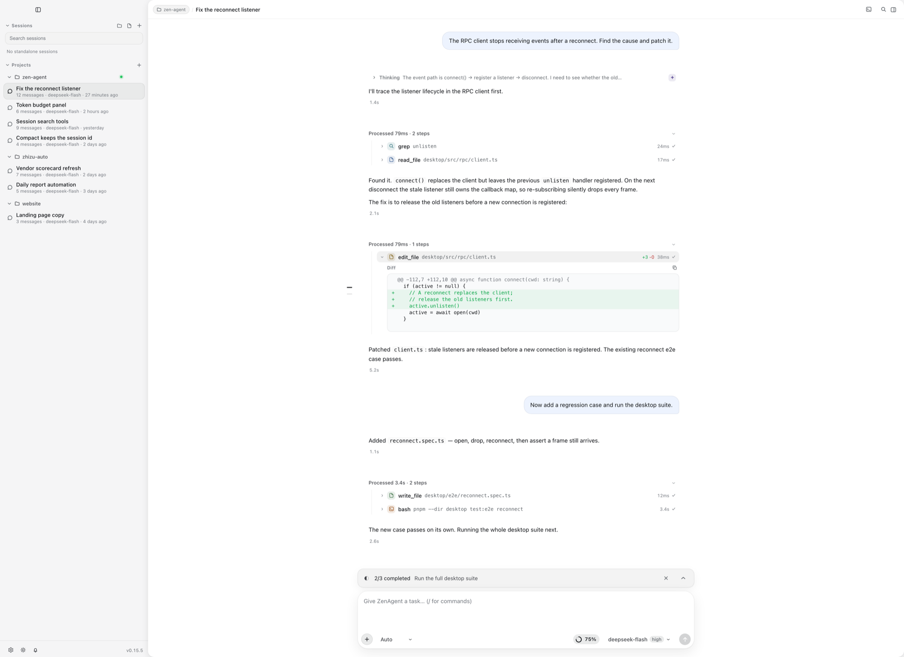
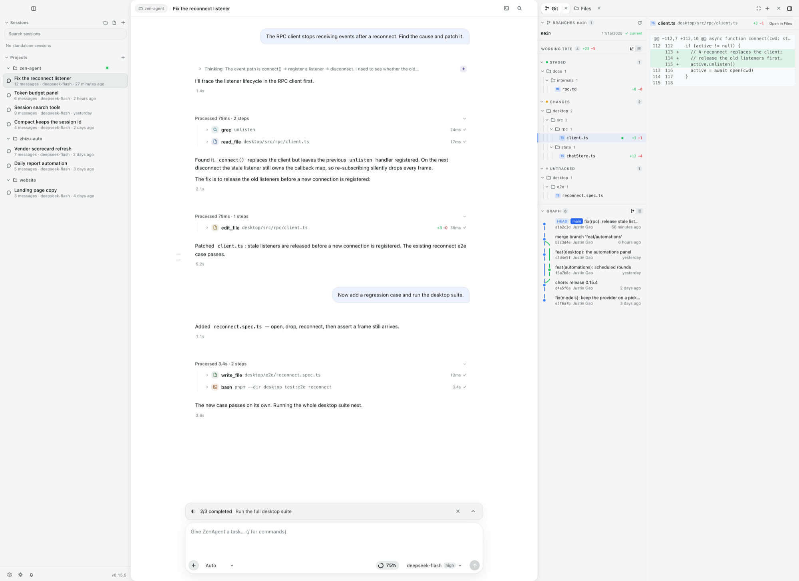

# ZenAgent

[](https://pypi.org/project/zenagent-py/)
[](https://github.com/encyc/zen-agent/actions/workflows/ci.yml)
[](https://www.python.org/downloads/)

English · [简体中文](https://github.com/encyc/zen-agent/blob/main/README.zh-CN.md)

A coding agent you can read, embed and change: one pure-Python kernel, one
runtime dependency (`httpx`), four surfaces — TUI, REPL, headless and RPC — plus
a desktop app that is just another client of the same runtime. It reads and edits
files, runs commands, searches the web, hands a self-contained job to a child
agent and keeps a task list — from the desktop app, a terminal, a headless
one-shot, or your own program.

Repo <https://github.com/encyc/zen-agent> · PyPI `zenagent-py` (imports as `zenagent`)



## One session, one agent

ZenAgent is a coding agent, not a workspace with modes to switch between. A
session is one conversation with one agent in one project. The desktop keeps a
session list per project, and every surface drives the same runtime; there is no
second orchestrator to supervise. Scheduled rounds, recall of earlier sessions
and child agents are tools the agent can use inside that session.

Permissions are the only mode: `plan` (read-only), `ask` (confirm writes and
commands) and `auto` (no prompts). `zen` starts in `ask`; `--mode` sets it.

## Install

```bash
uv tool install "zenagent-py[cli]"   # or: pip install "zenagent-py[cli]"
zen --version
```

Python **3.11+** (3.11–3.14 ship). A kernel-only install (`pip install zenagent-py`)
gives you the SDK without the terminal UI.

API keys are read from the environment, named per provider in
[`zenagent/catalog.yaml`](https://github.com/encyc/zen-agent/blob/main/zenagent/catalog.yaml):

| provider | env var |
|---|---|
| `openai` | `OPENAI_API_KEY` |
| `zai` | `ZAI_API_KEY` |
| `zai-coding-cn` | `ZAI_CODING_CN_API_KEY` |
| `deepseek` | `DEEPSEEK_API_KEY` |
| `kimi` | `KIMI_API_KEY` |
| `moonshotai`, `moonshotai-cn` | `MOONSHOT_API_KEY` |
| `minimax` | `MINIMAX_API_KEY` |
| `minimax-cn` | `MINIMAX_CN_API_KEY` |
| `google` | `GEMINI_API_KEY` |
| `xai` | `XAI_API_KEY` |
| `openrouter` | `OPENROUTER_API_KEY` |
| `xiaomi` | `XIAOMI_API_KEY` |
| `xiaomi-token-plan-cn` | `XIAOMI_TOKEN_PLAN_CN_API_KEY` |
| `xiaomi-token-plan-ams` | `XIAOMI_TOKEN_PLAN_AMS_API_KEY` |
| `xiaomi-token-plan-sgp` | `XIAOMI_TOKEN_PLAN_SGP_API_KEY` |
| `opencode-go` | `OPENCODE_API_KEY` |

Overseas and China endpoints are separate providers sharing one key (`moonshotai` /
`moonshotai-cn`); token-plan endpoints (`zai-coding-cn`, `xiaomi-token-plan-*`) bill 0.

A `[providers.custom.<id>]` table points the same kernel at any OpenAI-compatible
endpoint, a local server included — see
[configuration](https://github.com/encyc/zen-agent/blob/main/docs/guide/config.md).

### First run

```bash
zen                                     # TUI: transcript, tool cards, sidebar
zen --no-tui                            # line-based REPL over the same commands
zen -p "explain this repo" --json       # headless: one JSON object, CI-friendly
```

The TUI checks PyPI at most once an hour and prints one line when a newer release
exists; `-p`/`--json` never check. `ZENAGENT_NO_UPDATE_CHECK=1` turns it off.

## What this is, and why

Coding agents are either closed and vendor-tied, or large enough that changing one
layer means reading ten. ZenAgent is the small one: a Python kernel you can read
in an evening, embed in an afternoon, and change without permission.

- **One dependency.** `types`, `events`, `providers`, `agent` and `tools` import `httpx` and nothing else; the wheel stays under 1 MB and there is no daemon between you and the model.
- **Pure Python.** No node runtime, no build step — `pip install`, then run it.
- **One kernel, four surfaces.** TUI, REPL, headless (`-p`/`--json`) and `zen rpc` (a JSONL protocol) all drive the same runtime the same way.
- **A GUI is a client, not a rewrite.** The RPC surface already existed, so the Tauri desktop app reuses the same kernel instead of forking one — installers for macOS, Windows and Linux.
- **Embed it in 30 lines.** `Agent(model=..., tools=..., api_key=...)` plus one subscribe callback: your tools, your storage, your event loop.
- **Extend without restarting.** Skills, prompt templates, extensions, MCP servers and custom providers are all files; `/reload` picks them up mid-session.
- **No vendor lock-in.** Four protocol adapters (`openai-completions` — including the zai/deepseek dialects — `openai-responses`, `anthropic-messages`, `google-generative-ai`) plus a packaged catalog carrying prices and context windows.
- **Costs you can see.** `zen usage`, `/usage`, per-request cost in the transcript, and budget knobs in `[limits]`.
- **History is a tool.** `list_sessions`, `search_sessions` and `read_session` let the agent find what an earlier conversation settled instead of asking you to paste it.
- **A schedule is a file.** An automation is a saved prompt plus `daily HH:MM` or `every N<m|h>`; a per-project daemon runs it in a fixed session and leaves the report there.

## Features

| | What you get | Where |
|---|---|---|
| **A small kernel** | Six layers whose dependencies point strictly down; each layer is replaceable on its own | [architecture](https://github.com/encyc/zen-agent/blob/main/docs/architecture.md) |
| **Four surfaces** | TUI (transcript, tool cards, sidebar), REPL, headless one-shot, RPC/SDK | [CLI](https://github.com/encyc/zen-agent/blob/main/docs/guide/cli.md) · [TUI](https://github.com/encyc/zen-agent/blob/main/docs/guide/tui.md) |
| **Built-in tools** | files, bash with background jobs, grep/glob, web search + fetch, child agents, task list, project memory, LSP, GitHub (when `gh` is installed), checkpoint/rewind, cross-session search | [tools](https://github.com/encyc/zen-agent/blob/main/docs/guide/tools-permissions.md) |
| **55 commands** | one slash-command surface shared by the TUI and the REPL, with Tab completion | [commands](https://github.com/encyc/zen-agent/blob/main/docs/guide/commands.md) |
| **Extend it** | skills, templates, extensions, MCP servers, custom providers — all file-driven | [extensions](https://github.com/encyc/zen-agent/blob/main/docs/guide/extensions.md) · [MCP](https://github.com/encyc/zen-agent/blob/main/docs/guide/mcp.md) |
| **Automations** | a per-project daemon runs one round on a schedule; definitions are plain files the CLI and desktop share | [automations](https://github.com/encyc/zen-agent/blob/main/docs/guide/automations.md) |
| **Embed it** | `Agent` + `subscribe` in Python; `zen rpc` for every other language | [RPC & SDK](https://github.com/encyc/zen-agent/blob/main/docs/guide/rpc-sdk.md) |
| **Desktop app** | a Tauri shell over the same `zen rpc`: sessions and projects, split panes, files, Git review, terminal, memory, automations, approvals, self-update | [desktop](https://github.com/encyc/zen-agent/blob/main/desktop/README.md) |

### Desktop

The desktop is the same kernel behind a Tauri shell, and the fullest view of a
session: sessions and projects on the left, the turn in the middle, and a work
panel that keeps files, the Git review rail, a terminal, project memory and
automations beside the conversation. A session can be split beside another one
or popped out into its own window, and the host keeps the projects you have open
warm.

The review rail groups the working tree, opens an inline diff for any changed
file and draws the commit graph, so a change can be read without leaving the
conversation.



## Contributing

```bash
uv sync --extra cli      # kernel + terminal UI + dev tools
bash scripts/check.sh    # the only gate: sync + ruff + pytest (CI runs exactly this)
```

The package supports 3.11+, but the repository pins `.python-version` to 3.15 —
that is the `uv` toolchain, not the floor users need.

Where to read next:

| | |
|---|---|
| [Architecture](https://github.com/encyc/zen-agent/blob/main/docs/architecture.md) | The layers and what one request touches |
| [Slash commands](https://github.com/encyc/zen-agent/blob/main/docs/guide/commands.md) | All 55 commands |
| [Configuration](https://github.com/encyc/zen-agent/blob/main/docs/guide/config.md) | `config.toml`, providers, budgets |
| [Automations](https://github.com/encyc/zen-agent/blob/main/docs/guide/automations.md) | Scheduled rounds and the per-project daemon |
| [Contracts](https://github.com/encyc/zen-agent/blob/main/docs/reference/contracts.md) | The invariants the kernel is built on |
| [Development](https://github.com/encyc/zen-agent/blob/main/docs/development.md) | Gates, packaging check, releasing |
| [Docs index](https://github.com/encyc/zen-agent/blob/main/docs/README.md) | Everything else, in reading order |

**Not done: OS-level sandboxing.** The workspace fence and write snapshots protect
against agent mistakes, not against a malicious repository or prompt injection.

MIT licensed — see [LICENSE](https://github.com/encyc/zen-agent/blob/main/LICENSE).
