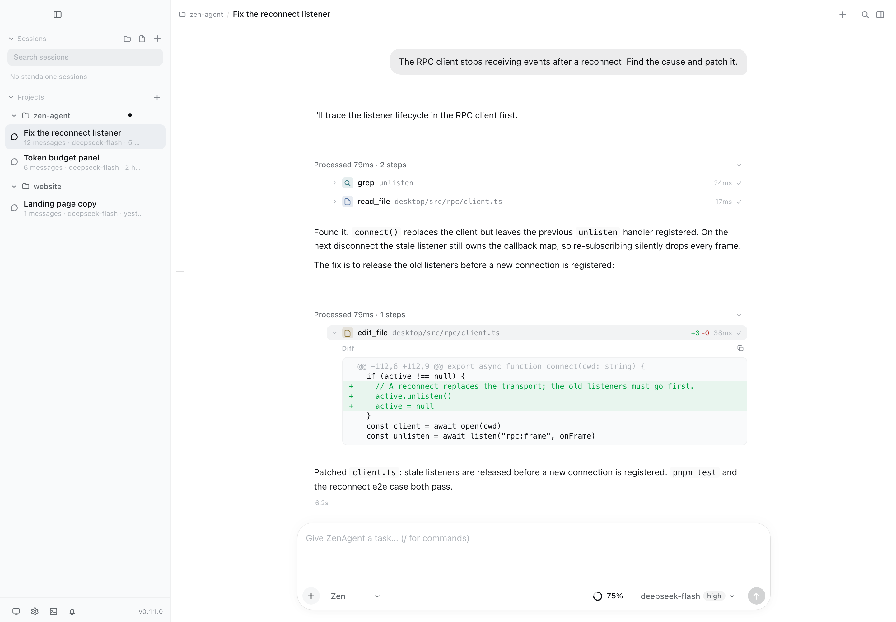
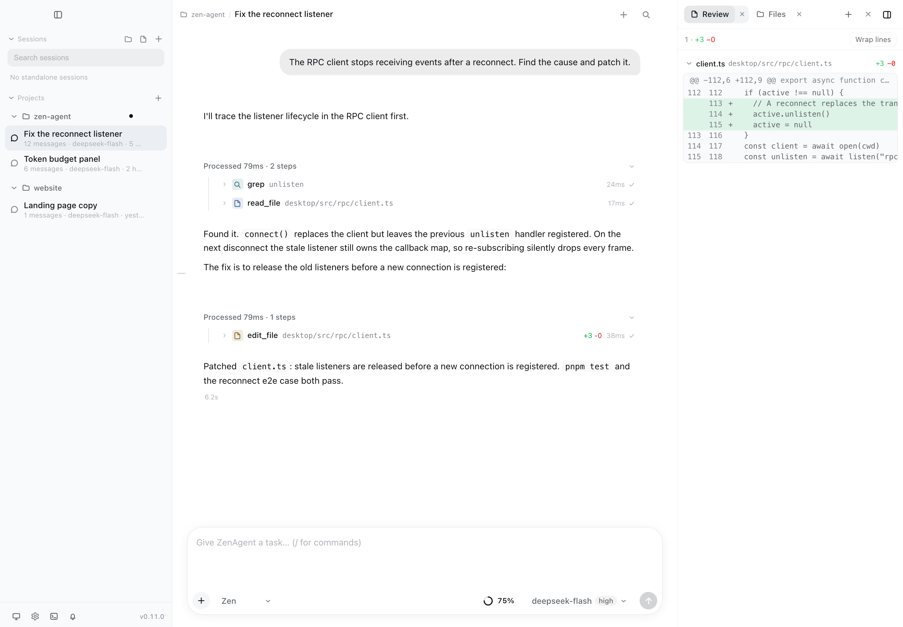
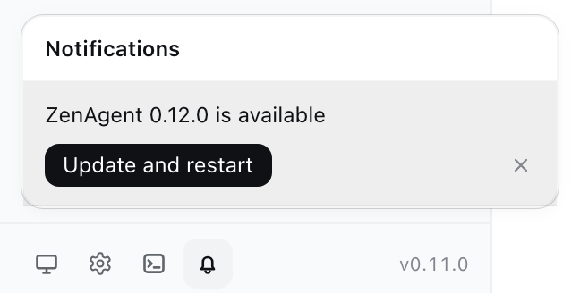

# ZenAgent

[](https://pypi.org/project/zenagent-py/)
[](https://github.com/encyc/zen-agent/actions/workflows/ci.yml)
[](https://www.python.org/downloads/)

简体中文 · [English](https://github.com/encyc/zen-agent/blob/main/README.md)

一个**能读完、能嵌进自己程序、能改**的编码代理：纯 Python 内核，运行时只依赖 `httpx`，
四种驱动它的方式。它读写文件、跑命令、联网搜索、把子任务交给只读子代理，还维护一份项目待办
——从终端、从一次性的 headless 调用，或从你自己的程序里都行。

仓库 <https://github.com/encyc/zen-agent> · PyPI 包名 `zenagent-py`（import 名 `zenagent`）



## 安装

```bash
uv tool install "zenagent-py[cli]"   # 或：pip install "zenagent-py[cli]"
zen --version
```

需要 Python **3.11+**（3.11–3.14 都发）。只装内核（`pip install zenagent-py`）拿到的是 SDK，
不含终端界面。

API key 从环境变量读，变量名按 provider 定义在
[`zenagent/catalog.yaml`](https://github.com/encyc/zen-agent/blob/main/zenagent/catalog.yaml)：

| provider | 环境变量 |
|---|---|
| `openai` | `OPENAI_API_KEY` |
| `zai` | `ZAI_API_KEY` |
| `zai-coding-cn` | `ZAI_CODING_CN_API_KEY` |
| `deepseek` | `DEEPSEEK_API_KEY` |
| `kimi` | `KIMI_API_KEY` |
| `moonshotai`, `moonshotai-cn` | `MOONSHOT_API_KEY` |
| `minimax` | `MINIMAX_API_KEY` |
| `minimax-cn` | `MINIMAX_CN_API_KEY` |
| `google` | `GEMINI_API_KEY` |
| `xai` | `XAI_API_KEY` |
| `openrouter` | `OPENROUTER_API_KEY` |
| `xiaomi` | `XIAOMI_API_KEY` |
| `xiaomi-token-plan-cn` | `XIAOMI_TOKEN_PLAN_CN_API_KEY` |
| `xiaomi-token-plan-ams` | `XIAOMI_TOKEN_PLAN_AMS_API_KEY` |
| `xiaomi-token-plan-sgp` | `XIAOMI_TOKEN_PLAN_SGP_API_KEY` |
| `opencode-go` | `OPENCODE_API_KEY` |

海外站与国内站是两个 provider，共用同一个 key（`moonshotai` / `moonshotai-cn`）。
包月套餐端点（`zai-coding-cn`、`xiaomi-token-plan-*`）按量计 0。

配一个 `[providers.custom.<id>]` 表，同一个内核就能指向任何 OpenAI 兼容的 endpoint（本地服务也算）
——见[配置](https://github.com/encyc/zen-agent/blob/main/docs/guide/config.md)。

### 第一次运行

```bash
zen                                     # TUI：转录、工具卡、侧栏
zen -p "explain this repo" --json       # headless：一个 JSON 对象，适合脚本/CI
```

TUI 每小时最多查一次 PyPI，有新版本时安静打一行；`-p`/`--json` 从不检查。
`ZENAGENT_NO_UPDATE_CHECK=1` 关掉它。

## 这是什么，为什么

编码代理要么闭源、锁死厂商，要么大到"改一层要先读十层"。ZenAgent 是那个小的：一个晚上能读完、
一个下午能嵌进项目、不需要谁批准就能改的 Python 内核。

- **只有一个依赖。** `types`、`events`、`providers`、`agent`、`tools` 只 import `httpx`，
  没有别的。wheel ~440 KB，`zen --version` 约 0.1 s。
- **纯 Python。** 没有 node runtime、没有编译步骤、中间没有 daemon —— `pip install` 就跑。
- **一套内核，四个入口。** TUI、REPL、headless（`-p`/`--json`）和 `zen rpc`（JSONL 协议）
  驱动的是同一个运行时，行为一致。
- **做 GUI 是写客户端，不是重写。** RPC 面已经存在，所以 Tauri 桌面端复用它，
  而不是 fork 一份内核 —— 提供 macOS、Windows、Linux 安装包。
- **三十行嵌进你的程序。** `Agent(model=..., tools=..., api_key=...)` 加一个 subscribe 回调：
  你的工具、你的存储、你的事件循环。
- **扩展不用重启。** skills、提示词模板、扩展、MCP server、自定义 provider 全是文件，
  `/reload` 当场生效。
- **不锁厂商。** 两个协议适配器（`openai-completions`，含 zai/deepseek 方言；`anthropic-messages`）
  加一份内置 catalog（带单价和上下文窗口）。
- **花费看得见。** `zen usage`、`/usage`、转录里逐轮成本，以及 `--max-cost` 硬闸。

## 特性

| | 你能拿到什么 | 去哪看 |
|---|---|---|
| **一个小的内核** | 五层依赖严格向下；每一层都能单独换掉 | [架构](https://github.com/encyc/zen-agent/blob/main/docs/architecture.md) |
| **四个入口** | TUI（转录、工具卡、侧栏）、REPL、headless 一次性调用、RPC/SDK | [CLI](https://github.com/encyc/zen-agent/blob/main/docs/guide/cli.md) · [TUI](https://github.com/encyc/zen-agent/blob/main/docs/guide/tui.md) |
| **内置工具** | 文件读写、带后台作业的 bash、grep/glob、联网搜索 + 抓取、子代理、待办、项目记忆、LSP、GitHub、checkpoint/rewind（`github` 只在装了 `gh` 时注册） | [工具与权限](https://github.com/encyc/zen-agent/blob/main/docs/guide/tools-permissions.md) |
| **48 条命令** | TUI 与 REPL 共用同一套斜杠命令，支持 Tab 补全 | [斜杠命令](https://github.com/encyc/zen-agent/blob/main/docs/guide/commands.md) |
| **可扩展** | skills、模板、扩展、MCP server、自定义 provider —— 全是文件驱动 | [扩展](https://github.com/encyc/zen-agent/blob/main/docs/guide/extensions.md) · [MCP](https://github.com/encyc/zen-agent/blob/main/docs/guide/mcp.md) |
| **可嵌入** | Python 里用 `Agent` + `subscribe`；其它语言用 `zen rpc` | [RPC 与 SDK](https://github.com/encyc/zen-agent/blob/main/docs/guide/rpc-sdk.md) |
| **桌面端** | 同一个 `zen rpc` 之上的 Tauri 外壳：会话、工作面板、审批、自动更新 | [desktop](https://github.com/encyc/zen-agent/blob/main/desktop/README.md) |

### 桌面端

同一个内核，套一层 Tauri 外壳：流式工具卡、内联 diff、审查与文件工作面板，
还有一个负责新版本提示的通知铃。diff 和文件留在对话旁边，新版本落在铃里，
而不是输入框上方的一条横幅。




## 参与贡献

```bash
uv sync --extra cli      # 内核 + 终端界面 + 开发工具
bash scripts/check.sh    # 唯一门禁：sync + ruff + pytest（CI 跑的完全一致）
```

包本身支持 3.11+，但仓库把 `.python-version` 固定在 3.15 —— 那是 `uv` 的开发工具链，
不是使用者的门槛。

接下来读什么：

| | |
|---|---|
| [架构总览](https://github.com/encyc/zen-agent/blob/main/docs/architecture.md) | 五层依赖，以及一次请求会碰到什么 |
| [斜杠命令](https://github.com/encyc/zen-agent/blob/main/docs/guide/commands.md) | 全部 48 条命令 |
| [配置与目录](https://github.com/encyc/zen-agent/blob/main/docs/guide/config.md) | `config.toml`、provider、预算 |
| [核心契约](https://github.com/encyc/zen-agent/blob/main/docs/reference/contracts.md) | 内核赖以成立的不变量 |
| [开发与发版](https://github.com/encyc/zen-agent/blob/main/docs/development.md) | 门禁、打包检查、发版流程 |
| [文档索引](https://github.com/encyc/zen-agent/blob/main/docs/README.md) | 其余全部，按阅读顺序 |

**还没做的：OS 级沙箱。** 工作区围栏和写入快照防的是 agent 犯错，不是恶意仓库或提示注入。

MIT 许可 —— 见 [LICENSE](https://github.com/encyc/zen-agent/blob/main/LICENSE)。
