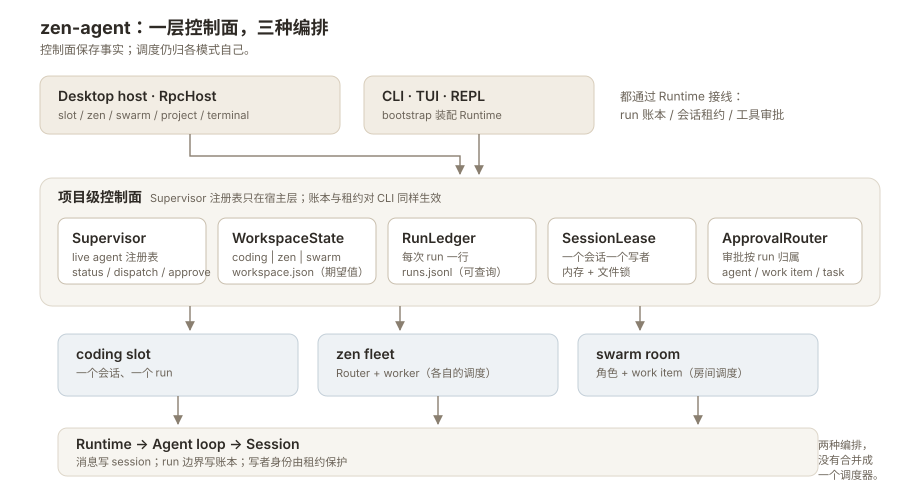

# 控制面：Supervisor、运行账本与派工

Coding、Zen、Swarm 仍按各自的方式编排，但现在共用一层**项目级控制面**：谁活着、
项目处于哪个模式、一次 run 的边界和归属、审批该回到谁、同一个会话能不能再开一个
写者。这一层不替代任何模式的调度器；它把三种模式原本各自维护的事实放到同一个地方，
让宿主和桌面壳可以跨模式查询。



上图的读法：桌面宿主 `RpcHost` 持有项目级控制面；CLI/TUI/REPL 没有 Supervisor 注册表，
但仍通过 `Runtime` 的接线写入同一本 run 账本，并受同一套会话租约约束。

## 组件与事实

| 组件 | 它回答的问题 | 存储 / 入口 |
|---|---|---|
| `AgentProfile` | 这是谁、能装配什么能力 | 内存对象；`RuntimeOptions.profile` |
| `Supervisor` | 这个项目里现在有哪些 agent 活着 | 内存注册表；`supervisor op=status` |
| `WorkspaceState` | 项目期望处于哪个模式 | `~/.zenagent/projects/<key>/workspace.json` |
| `RunLedger` | 哪些 run 跑过、归属谁、怎么结束 | `~/.zenagent/projects/<key>/runs.jsonl` |
| `SessionLease` | 这个会话是否已有写者 | 进程内注册表 + `~/.zenagent/locks/` |
| `ApprovalRouter` | 这条待审批属于哪个 run / agent / 工单 | 内存路由；`approval` 与 `supervisor op=approve` |
| `Dispatcher` | 这个模式的派工入口是什么 | Zen / Swarm 各自挂载；`supervisor op=dispatch` |

## Supervisor：项目里的 live agent

`Supervisor` 是**每项目一个**的注册表，不是新的调度器。注册发生在 runtime 装配完成、
准备接受派工时：

- coding / RPC slot：以 slot key 注册，`kind=coding`；
- Zen Router：`kind=zen_router`，profile id 为 `router`；
- Zen worker：`kind=zen_worker`，key 形如 `zen:<session stem>`；
- Swarm 的每个 `(role, work item)` run 单元：`kind=swarm`，key 形如
  `<role>@<workItem|adhoc>`。

`supervisor op=status` 是跨模式的“现在有什么在跑”查询面。它返回项目模式、live agent
快照、运行中计数和待审批列表（跨项目，条目自带 `project`）；每个快照带 `key` / `agent` / `kind` / `label` /
`state`（`running|idle`）/ `session` / `runId`，以及 zen/swarm 的关联字段：

```json
{
  "type": "supervisor", "id": "s1", "op": "status", "project": "/repo"
}
```

```json
{
  "ok": true,
  "mode": "zen",
  "agents": [
    {"key": "zen:worker-a", "agent": "worker-a", "kind": "zen_worker",
     "state": "running", "runId": "r_18f...", "session": "..."}
  ],
  "counts": {"agents": 1, "running": 1},
  "approvals": []
}
```

注册表只代表**存在**，不代表状态权威：worker 的焦点和最近报告仍以 Zen 名册为准，
任务终态仍以 Swarm 的 `tasks.jsonl` 为准。反过来，名册/任务表也不知道所有 slot 和
coding run，想知道“整个项目现在在跑什么”时才看 Supervisor。

## 模式事实：workspace.json

`~/.zenagent/projects/<key>/workspace.json` 保存项目期望模式：

```json
{"mode": "coding", "updatedAt": 1762..., "routerSession": "..."}
```

- `workspace op=get/set` 是宿主级 RPC；`set` 幂等，并广播 `workspace` 帧。
- 桌面启动、切项目、切模式时以后端值校准；`localStorage` 里的旧选择只是离线缓存。
- `routerSession` 只在 Zen 模式写入，指向该项目的 Router 会话。
- **它只记录期望，不负责生命周期**：`set` 不会启动 fleet、打开房间或关闭任何 runtime；
  进入/离开 Zen、打开/回收 Swarm 房间仍是各编排器的动作。

## 运行账本：runs.jsonl

会话文件记录**消息**，run 账本记录**一次运行**。一行一条 JSON，同一 `id` 最后一条
胜出；坏行跳过，写入是 best-effort，磁盘问题不会中断 agent run。

```json
{
  "type": "run", "version": 1, "id": "r_18f...",
  "kind": "zen_worker", "status": "done",
  "startedAt": 1762..., "endedAt": 1762..., "durationMs": 8123,
  "agentId": "worker-a", "session": "...", "workItemId": null,
  "parentRunId": "r_18e...", "taskId": null, "label": "tests",
  "termination": "stop", "turns": 4, "cost": 0.0123, "error": null
}
```

`kind` 取 `coding` / `zen_router` / `zen_worker` / `swarm` / `subagent`；`status` 取
`running` / `done` / `failed` / `aborted` / `cancelled` / `interrupted`。终止原因与状态
的映射是保守的：只有 `stop` 和 `tool_terminate` 算 `done`，预算/错误类终止算
`failed`，协作中止算 `aborted`。

查询走宿主级 RPC（跨模式、只读）：

```json
{"type": "runs", "id": "r1", "op": "list", "project": "/repo",
 "kind": "swarm", "limit": 20}
{"type": "runs", "id": "r2", "op": "get", "project": "/repo", "runId": "r_18f..."}
```

`list` 支持 `kind` / `agent` / `workItem` / `session` / `status` / `since` / `limit`，
按最新在前返回；字段与磁盘记录一致，但去掉 `type` / `version` 信封。也可以直接读
文件：

```bash
jq -c 'select(.type == "run")' ~/.zenagent/projects/*/runs.jsonl | tail -20
```

**崩溃对账**发生在 runtime 装配时，而不是 `runs` 查询时：

- 当前 runtime 已经持有该 session 的 writer lease，所以同路径旧的 `running` 行不可能
  属于活进程，直接追加 `interrupted`；
- 同一账本每个进程再扫一次，用 lease 探针判断其他 session 是否还有写者；探针失败按
  “活着”处理，避免误杀；
- 收口只追加状态、结束时间和原因，保留原来的归属字段；
- 没有 session 的行不碰——没有 lease 就没有死亡证据。

因此 `runs list` 是纯读：一个进程崩溃后，残留的 `running` 行会在下一次有 runtime
打开该项目时被收口，而不是在你查询时被改写。

**subagent 行的归属**：`task` 工具派生的子代理没有独立 session，账本行记在父 session
和父 run 下（`kind=subagent`、`parentRunId` 指向派发时的父 run）。父会话恢复时，
这些行随父 session 一起收口。

## 单写者租约

一个会话同一时间只允许一个写者。`Runtime` 绑定 session 时取得 `SessionLease`：

- 同进程内第二个 runtime 绑定同一 session 会得到 `SessionLeaseBusy`；
- 跨进程用 `~/.zenagent/locks/` 下的 advisory lock 兜底，第二个 CLI 进程同样被拒绝；
- `session resume` / `switch_session` 在 abort 当前 run **之前**检查目标会话，忙时
  当前会话和它的 run 都保持不动；
- 只读的 transcript 快照不受影响——桌面打开 worker 抽屉、`transcript` RPC 都不会
  抢写者。

错误会以 `session_lease_busy` 回到前端。处理方式不是重试，而是先关闭占用该会话的
runtime / 进程，再恢复。这条规则也解释了为什么两个终端不能同时 `--resume` 同一个
会话文件。

## 统一派工入口

`supervisor op=dispatch` 把“把任务交给某个模式”收成一个请求；具体调度仍由模式自己
决定：

| 模式 | 派工入口 | 返回 |
|---|---|---|
| coding | 不派工；直接 `session prompt` | 一轮 run |
| zen | `supervisor op=dispatch`，目标 `session` 或 live `agent` key | worker 状态 |
| swarm | `supervisor op=dispatch`，可带 `role` / `ref` / `images` | task ids / 房间状态 |

```json
{"type": "supervisor", "id": "d1", "op": "dispatch", "project": "/repo",
 "mode": "swarm", "prompt": "@research 对比这两个方案", "images": ["shot.png"]}
```

- `mode` 省略时读 `workspace.json`；`coding` 会被拒绝（单会话应该直接 prompt）。
- Zen 的 `session` 与 `agent` 同时给出且不一致时拒绝；没有挂载 dispatcher（fleet /
  room 未启用或已 detach）返回 `dispatch_unavailable`。
- 关闭中的 fleet、未知角色、忙 worker 等策略拒绝返回 `dispatch_rejected`；
  `ref` / `images` 原样转发，引用和附件不会因为换入口而丢失。
- **回执只确认“已交给编排器”**：不会伪造 `runId`。真正的 run 身份由 runner 在开始
  执行时写入账本，之后用 `runs` 查询。

## 三种模式如何落到控制面

| 模式 | run 单位 | 账本 kind | live 注册 key | 状态权威 |
|---|---|---|---|---|
| Coding | 一个会话 | `coding` | RPC slot key | `ChatController` |
| Zen Router | 项目一个 Router 会话 | `zen_router` | Router slot key | Zen 名册 |
| Zen Worker | worker 会话 + 派工 | `zen_worker` | `zen:<session stem>` | Zen 名册 |
| Swarm | `(role, work item)` | `swarm` | `<role>@<item\|adhoc>` | `tasks.jsonl` |
| Subagent | 父 run 内的一次 child dispatch | `subagent` | 不注册 | 父 run |

## 两个编排器的分工

Zen 和 Swarm 在 `Runtime` 之上各长一套，共用控制面但不共用调度器。一句话分工：
**Zen 是「派完就算完，结果飘回来」**，**Swarm 是「房间长期在线，谁都能围观」**。
worker 与 run unit 都走 `prepare()` 装配，与 coding 同一个入口。

下面这些差异是**有意的**，不要为了整齐去合并：

| 维度 | Zen | Swarm | 为什么 |
|---|---|---|---|
| 结果回传 | 终局文本 `chat.deliver`（无则 `steer`）回灌 router，批量合并 | room 消息 + `tasks.jsonl` 状态机 | router 只需要结论；房间需要过程可围观 |
| 事件可见性 | 只看终局报告 | `events_tap` 实时转发每个角色事件 | 同上 |
| 超时收尾 | abort + 把「运行超时」注入 router | `abort_outcome` + 等 idle，由 manager 记终态 | worker 的失败是给 router 的一条消息；run unit 的失败是房间的一条记录 |
| 生命周期 | 每次 dispatch 结束即 `close()` | 空闲保留，`runtime_idle_s` 后回收 | worker 按需造；房间成员要能复用 |
| 并发 | 信号量 + `queued` 状态 | 轮次调度 + 收件箱 gate | 前者限流，后者排程 |

已经拉齐的两处：zen worker 继承 router 的模型与 thinking，预算取 `[task]` 的
`task_max_turns` / `task_max_cost`；`auto` 仍降级成 `ask`，但降级后的 worker 通过
`slot.server.ask` 能问到人，不再走进「既不自动放行也问不了」的死角。

## 边界

- **两套调度器没有被合并**：Zen 的 router/worker 调度和 Swarm 的房间调度各自保留；
  `supervisor dispatch` 只是统一入口。
- **账本是投影，不是替代**：Swarm 任务状态以 `tasks.jsonl` 为准，Zen worker 状态以
  名册为准；用户取消的任务在账本里可能仍记为 `aborted`。
- **workspace 不是生命周期**：切模式只写期望值，启动/停止 fleet、打开/回收房间仍由
  各编排器执行。
- **对账是惰性的**：`runs` 查询不会触发收口；没有 runtime 打开的项目会暂时保留
  `running` 残留。
- **没有 retention**：`runs.jsonl` 只追加，目前不自动清理。
- **Supervisor 只在宿主层**：CLI/TUI/REPL 也写账本、也受租约约束，但没有项目级
  live-agent 注册表。

## 源码对照

| 关注点 | 文件 |
|---|---|
| profile / registry / dispatch mount | `zenagent/app/agent_profile.py` |
| dispatch strategies | `zenagent/app/dispatch.py` |
| workspace state | `zenagent/app/workspace_state.py` |
| run ledger | `zenagent/app/runs.py`、`zenagent/app/run_wiring.py` |
| subagent rows | `zenagent/app/subagent_runs.py` |
| session lease | `zenagent/app/session_lease.py` |
| approval router | `zenagent/app/approval_router.py` |
| host RPC | `zenagent/cli/rpc/host.py`、`ops_supervisor.py`、`ops_runs.py`、`ops_workspace.py` |
| 更深的实现说明 | [`internals/supervisor.md`](../internals/supervisor.md)、[`internals/run-ledger.md`](../internals/run-ledger.md) |
| 测试 | `tests/test_agent_profile.py`、`tests/test_dispatch.py`、`tests/test_workspace_state.py`、`tests/test_run_ledger.py`、`tests/test_subagent_runs.py`、`tests/test_session_lease.py`、`tests/test_approval_router.py`、`tests/test_rpc_supervisor.py`、`tests/test_rpc_runs.py` |
