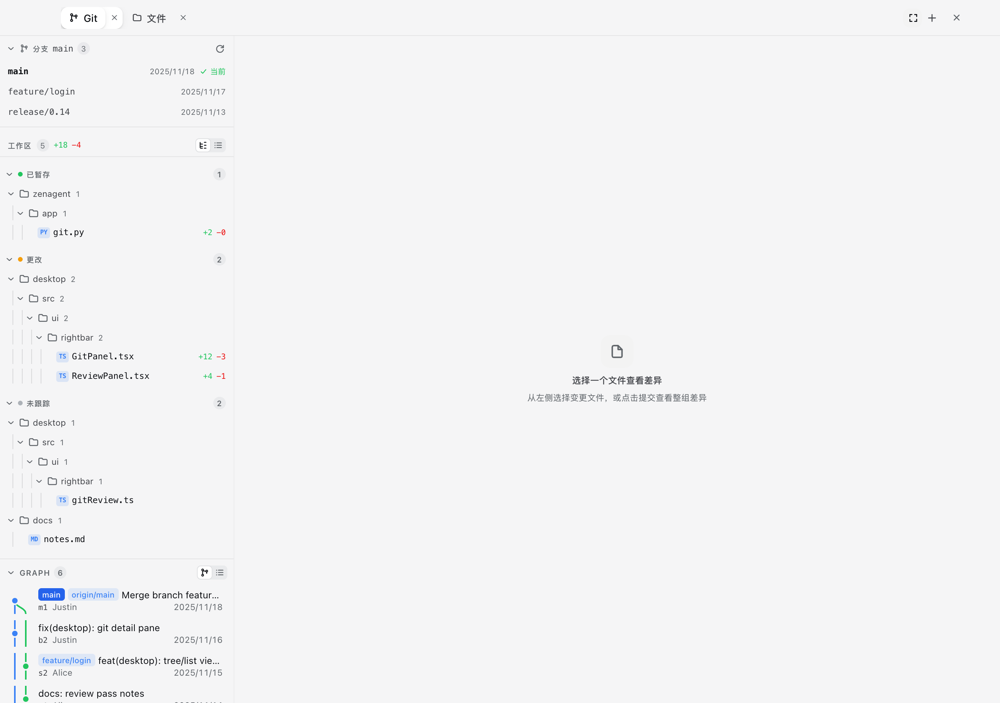
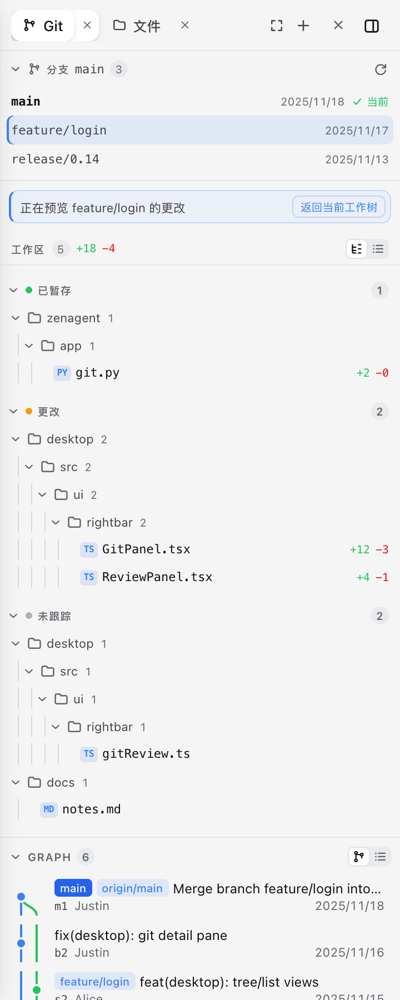
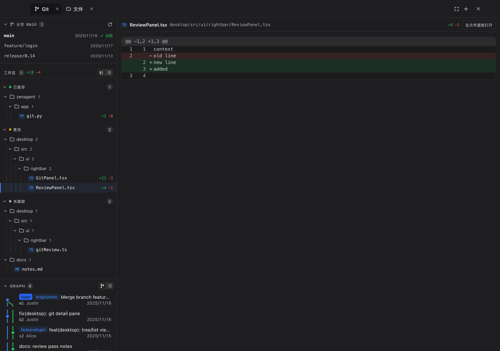

# Git Review Rail — UI 设计

> 对象：工作面板（Work Panel）里的 **Git** tab。目标是把"看变更 / 看提交 / 看历史"做成一条
> 安静、密集、可扫读的审阅轨道，而不是三个各自为政的列表。

## 1. 设计方向

**Quiet review rail（安静的审阅轨道）**：Minimalism & Swiss 的网格与层级，借用 IDE 的密度，
用功能色只标注状态，用蓝色只标注"当前操作"。

来自 UI/UX Pro Max 的检索结果只取方向，不套模板：

- 产品类型 `Developer Tool / IDE` → Dark Mode (OLED) + Minimalism & Swiss，蓝色作为焦点色；
  该结果与现有产品的 token 体系一致。
- 生成器给出的 teal / orange 落地页色板属于通用建站模板，与本产品既有 token 冲突，**不采用**。
- 全量色板仍由 `desktop/src/styles/tokens.css` 提供，不新增品牌色。

三条原则：

1. **层级先于装饰**：分支 → 工作区 → 分组 → 文件 → 详情，靠 30/25/24px 的节奏和字号拉开，
   不靠卡片、阴影或渐变。
2. **状态优先**：已暂存（绿）、更改（琥珀）、未跟踪（中性）用 6px 圆点 + 文本标签双重编码；
   蓝色只表示选中 / 预览 / 焦点，不用来表示"当前分支"。
3. **密集但可读**：路径、hash、计数用等宽字体；目录前缀降一级；缩进用 hairline 导轨；
   行高 25px（桌面指针密度），不为了触屏把开发工具拉成 44px 的营销页。

## 2. Token 与排版

| 用途 | Token / 值 |
| --- | --- |
| 面板底色 | `--ds-surface-sidebar` |
| 主文本 | `--dsw-alias-label-primary` |
| 次级文本 | `--dsw-alias-label-secondary` |
| 弱文本 / 元信息 | `--dsw-alias-label-tertiary` |
| 选中 / 预览 / 焦点 | `--dsw-static-blue-500` |
| 新增 / 已暂存 | `--dsw-alias-state-success-primary` |
| 更改 | `--dsw-alias-state-warn-primary` |
| 删除 | `--dsw-alias-state-error-primary` |
| 分隔线 | `--ds-hairline` / `--ds-hairline-strong` |
| 悬停底 | `--ds-surface-hover` |
| 动效 | `--ds-motion-fast` + `--ds-ease-out` |

排版：

- 章节标签：10px / 600 / uppercase / `0.06em`，弱文本。
- 计数：10px tabular，16px 高的 pill。
- 文件名 / 分支名 / hash：11px 等宽。
- 提交 subject / 文件详情名：12px / 600。
- 正文 diff：沿用 `DiffBlock` 的 12px 等宽与既有行高。

## 3. 布局

```
┌ 分支 ────────────────────────────── 3  ↻ ┐   32px
│  main            2025/11/18   ✓ 当前      │   26px
│  feature/login   2025/11/17               │
├ 工作区  5   +18 −4          [树] [列表] ──┤   30px
│  ● 已暂存                            1    │   24px
│    ▾ zenagent                             │
│      ▾ app                                │
│        PY git.py                  +2 −0   │
│  ● 更改                              2    │
│    …                                      │
│  ● 未跟踪                            2    │
├ Graph  6                    [图] [列表] ──┤   30px
│  ●─┐ main origin/main Merge …             │   36px
│    ● fix(desktop): …                      │
└───────────────────────────────────────────┘
```

- **宽栏（≥520px）**：左侧 300px 列表 + 右侧详情；详情头 36px，diff 区 10px 内边距。
- **窄栏（<520px）**：列表 → 详情单栏，详情头出现 24px 返回按钮；分支、分组、Graph 均可折叠。
- **真全屏**：rail 独占窗口；darwin 下 header 留 78px 给红绿灯。

## 4. 组件解剖

### 4.1 分支区

- 头部：chevron + 分支图标 + `分支` + 当前分支（等宽）+ 数量 pill + 刷新。
- 当前行：绿色 `✓ 当前`，名称加粗；**不铺蓝底**。
- 预览行：蓝色 8% 底 + 左侧 2px 蓝条；预览条出现在工作区上方，说明"正在预览 X"。
- 行点击 = 只读预览，不重启 runtime；列表高度上限 168px，内部滚动。

### 4.2 工作区工具栏

`工作区` + 文件数 + `+N −M` 总变更 + 树/列表分段开关。总数让审阅者在展开详情前就知道规模。

### 4.3 分组头

24px 高，chevron + 6px 状态点 + 标签 + 计数 pill；整行可点，`aria-expanded`。
三个分组（已暂存 / 更改 / 未跟踪）各自记住目录折叠状态。

### 4.4 文件行

- 25px 高；`padding-left = 8 + depth × 12`；绝对定位的 1px 导轨显示祖先层级。
- 目录行：chevron + 14px 文件夹图标 + 名称 + 递归文件数。
- 文件行：12px 占位（与目录 chevron 对齐）+ 16px 文件类型徽章（`fileBadge`）+ 路径 + `+N −M`。
- 树模式只显示 basename；列表模式把目录前缀降为弱文本，basename 保持主文本。
- 选中：蓝色 8% 底 + 左侧 2px 蓝条；悬停 140ms；`aria-current` + 完整路径的 `aria-label`。
- 本会话改动用 6px 绿点标记（`title` 由行提供完整路径，视觉点不参与可达名称）。

### 4.5 Graph

- 36px 两行：refs pills + subject；短 hash + 作者 + 日期。
- lane SVG 只画穿过本行的线；当前分支实心蓝 pill，其他分支浅蓝，tag 中性。
- 选中行同样使用左侧蓝条 + 8% 底；列表模式隐藏 lane 列。
- 头部可折叠，折叠状态写入 `localStorage`。

### 4.6 详情头与空状态

- 详情头：文件类型徽章 / 提交图标 + 名称 + 路径（弱文本）+ `+N −M` + "在文件面板打开"。
- 未选中时不再是一行角落提示，而是居中的 42px 图标 + 标题 + 一句操作提示。
- diff 块保持无卡片边框的代码表面，只有 hunk 与增删行使用功能色。

## 5. 交互与动效

- 所有悬停/选中过渡 140ms `ease-out`；`prefers-reduced-motion` 下关闭。
- 折叠/展开即时（不做高度动画），避免在长列表里抖动。
- 键盘：Tab 顺序与视觉顺序一致；分组/章节头 `aria-expanded`；文件/提交行 `aria-current`；
  所有按钮保留 2px 内嵌焦点环。
- 颜色不作唯一信息：分组点旁边始终有文字，当前分支有 `✓ 当前`。

## 6. 有意避免

- 卡片化文件行、阴影、渐变、圆角过大——会把开发工具做成仪表盘。
- 给"当前分支"铺整行蓝底——会和"正在预览"混淆。
- 蓝色 / 绿色语义混用；未跟踪使用中性灰而不是绿色。
- 为触屏放大到 44px 行高；本产品是桌面指针场景，密度优先。
- 使用 emoji 作为文件/状态图标；全部沿用 16px stroke SVG 与静态文件类型徽章。

## 7. 验收

- 宽 / 窄、亮 / 暗四组截图人工核对层级、对比度与截断。
- e2e 覆盖：分支折叠、同名目录独立折叠、分组/Graph 折叠、树/列表切换、选中态、预览条。
- `pnpm lint:tokens` 不得出现裸色值；所有新样式只消费既有 token。

## 8. 设计稿

宽栏（全屏、亮色，列表 + 空详情）：



窄栏（工作树预览、亮色）：



宽栏详情（暗色）：


